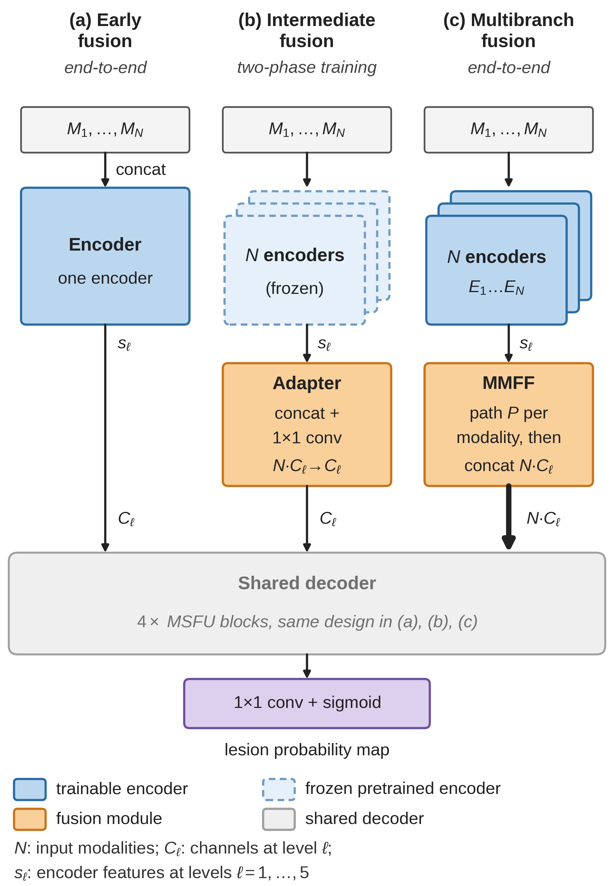

# More Modalities, Better Detection? A Systematic Comparison of MRI Fusion Strategies for Multiple Sclerosis Segmentation


 

> **Key finding:** Giving every MRI sequence its own encoder (intermediate or multi-branch fusion) clearly beats stacking the sequences as input channels (early fusion). On the ISBI 2015 test set, intermediate fusion (FLAIR, T1w, T2w, PD) and multi-branch fusion (FLAIR, T1w, PD) reach challenge scores of **92.80** and **92.78**, slightly above the 92.661 of Raab et al. Replacing T2w by PD improved the score for all three fusion strategies.

---

## Overview

This repository compares **three ways of fusing multi-modal MRI** in the same 2D U-Net for automatic MS lesion segmentation on the [ISBI 2015 longitudinal challenge](https://smart-stats-tools.org/lesion-challenge) data, for **every combination of FLAIR, T1w, T2w and PD** (15 combinations x 3 strategies = **45 networks**). It builds on the multi-branch framework of Raab et al. (*Scientific Reports*, 2023), re-implemented in PyTorch with a single code base for all strategies.

| Strategy | Encoders | Where the modalities are merged | Training |
|---|---|---|---|
| `early` | 1 | Input: modalities stacked as channels | End-to-end |
| `intermediate` | one per modality | Every level: concatenation + 1x1 convolution back to `C` channels | Two phases: encoders pretrained separately, then frozen while fusion layers and decoder are trained |
| `multibranch` | one per modality | Every level: per-modality conv paths (MMFF), concatenated without compression | End-to-end |

All strategies share the same backbone (4 down-sampling blocks + bottom block, 32 to 512 filters) and the same decoder design (multi-scale feature up-sampling, MSFU). Training and validation images are slices from the axial, coronal and sagittal planes; test volumes are predicted in all three planes and the probabilities are averaged.

Hardware used: NVIDIA RTX 5070 Ti · Intel Core Ultra 9 · 32 GB RAM

---

## Results at a glance

Challenge score (SC) on the 14 ISBI 2015 test subjects (61 scans), averaged over both raters. A score of 90 or higher is considered comparable to a human rater.

| Strategy | Best configuration, phase 1 (3 training subjects) | SC | Best configuration, phase 2 (Raab et al. protocol) | SC |
|---|---|---|---|---|
| Early | T1w + T2w | 91.37 | T1w + T2w | 91.25 |
| Intermediate | FLAIR + T2w + T1w + PD | 92.65 | FLAIR + T1w + T2w + PD | **92.80** |
| Multi-branch | FLAIR + T1w + PD | 92.48 | FLAIR + T1w + PD | 92.78 |
| *Raab et al. (FLAIR + T1w + T2w)* | | | | *92.661* |

- **Phase 1** trains all 45 networks with identical hyper-parameters on three training subjects (fold `_123_4`). Mean SC per strategy: early 90.41, intermediate 91.25, multi-branch 91.28. The early mean excludes the PD-only network, which predicted no lesions.
- **Phase 2** retrains the best network of each strategy following the training protocol of Raab et al. (all five training subjects, the last time point of each subject held out for validation).
- Intermediate fusion peaked at about **6.3 GB VRAM** and needed about 3 h of training plus 1 h of separate encoder pretraining. Raab et al. report 4.2 h and 9.4 GB on different hardware and framework.
- Single training run per configuration, single dataset. The top models differ by less than 0.3 SC points, so treat small differences with care.

<!-- TODO: add here the exact command / script used for the phase-2 training -->

---

## Requirements

### System

- Python 3.10+
- CUDA-capable GPU (mixed precision is used; 6.3 GB peak VRAM was measured for intermediate fusion, other configurations were not measured)
- CUDA 12.x or later

### Python packages

```bash
pip install -r requirements.txt
```

Install PyTorch separately for your CUDA version (see [pytorch.org](https://pytorch.org/get-started/locally/)), for example for CUDA 12.8:

```bash
pip install torch --index-url https://download.pytorch.org/whl/cu128
```

Main dependencies (see `requirements.txt` for the full list):

```
torch
numpy
scipy
scikit-learn
scikit-image
nibabel
opencv-python
Pillow
matplotlib
tqdm
psutil
```

---

## Project structure

Data folders are resolved **relative to the parent of the code folder** (`REPO_ROOT` in the scripts).

```
<repo root>/
├── <code folder>/
│   ├── train.py              # training (all fusion strategies, 20 subject-wise fold combinations)
│   ├── architecture.py       # U-Net with fusion="early" | "intermediate" | "multibranch"
│   ├── data_generator.py     # PNG slice loader, modality selection, augmentation
│   ├── slicer.py             # NIfTI volume -> PNG slices (three planes)
│   ├── folder_structure.py   # fold / directory management
│   ├── losses.py             # Dice + BCE loss
│   ├── utils.py              # logging helpers and metrics
│   ├── slice_test.py         # slice the ISBI test volumes (writes test_manifest.json)
│   ├── predict_test.py       # predict with every trained model, export NIfTI masks, gather results
│   └── view_masks.py         # overlay predicted masks on the MRI as PNG montages
├── training/                 # raw ISBI 2015 training data
├── training_sliced/          # PNG slices written by slicer.py
├── trained_models/           # checkpoints and logs
├── testdata/                 # raw ISBI 2015 test data
└── requirements.txt
```

---

## Data preparation

Download the **ISBI 2015 longitudinal MS lesion segmentation** data (5 training subjects with two raters, 14 test subjects; FLAIR, T1w, T2w, PD). The preprocessed volumes released by the organizers are used.

### Expected raw data layout

```
training/
├── training01/
│   ├── preprocessed/
│   │   ├── training01_01_flair_pp.nii
│   │   ├── training01_01_mprage_pp.nii      # T1w
│   │   ├── training01_01_t2_pp.nii
│   │   └── training01_01_pd_pp.nii
│   └── masks/
│       ├── training01_01_mask1.nii
│       └── training01_01_mask2.nii
├── training02/ ...
└── training05/
```

The test set (`testdata/test01/ ... test14/`) uses the same layout without the `masks/` folder.

### Slicing the volumes into PNG slices

Run the training script once with `-s True` to slice all training volumes. This only has to be done once.

```bash
python train.py -s True -ep 1
```

> The `-s` flag uses Python's `bool`, so **any** value (even `False`) turns slicing on. Leave the flag out to skip slicing.

Every volume is min-max normalised and sliced along the axial, coronal and sagittal planes. Each slice is resized to 256x256 pixels and saved as `<subject>_<timepoint>_<view>_slice<index>.png`, e.g. `training01_01_axial_slice045.png`. Two sets are written per subject:

- **train**: all slices containing lesions plus every 30th lesion-free slice
- **valid**: all slices

---

## Training

### Run training

```bash
python train.py --fusion intermediate --modalities flair t1 pd -m mask1 -f 32 -exp ISBI -n 0
```

### Arguments

| Argument | Flag | Default | Description |
|---|---|---|---|
| Fusion | `--fusion` | `early` | `early`, `intermediate` or `multibranch` |
| Modalities | `--modalities` | `flair t1 t2` | Any subset of `flair t1 t2 pd`. **The order is the branch order** and must be the same for training and prediction |
| Mask | `-m` | `mask1` | Rater mask used for training (`mask1` or `mask2`) |
| Epochs | `-ep` | `200` | Maximum number of epochs |
| Filters | `-f` | `32` | Filters in the first encoder block (doubled at every level) |
| Experiment | `-exp` | `ISBI` | Experiment name used in the output folder |
| Batch size | `-bs` | `26` | Training batch size |
| Folds | `-n` | `0` | `0`: first combination only (`_123_4`), `1`-`4`: five combinations each, otherwise all 20 |
| Slice | `-s` | `False` | Slice the NIfTI volumes before training (see note above) |
| Patience | `--patience` | `10` | Early stopping: epochs without improvement (0 disables it) |
| Min. delta | `--min_delta` | `1e-4` | Smallest validation-F1 increase that counts as an improvement |
| Phase-1 epochs | `--p1_epochs` | `20` | Encoder pretraining epochs (intermediate fusion only) |
| No pretraining | `--no_pretrain` | off | Intermediate fusion without encoder pretraining and freezing (ablation) |
| Workers | `--num_workers` | `12` | DataLoader workers per loader |
| Preview | `--preview_every` | `5` | Save a validation preview image every N epochs |

### Training details

- Adam, learning rate 3e-4, reduced on plateau; Dice + BCE loss; mixed precision (float16) with loss scaling.
- Augmentation (same transform for all modalities of a slice): rotation of up to 360 degrees, horizontal/vertical flips, shifts up to 30%, zoom 0.5 to 1.5, brightness 0.5 to 1.5.
- Early stopping and `BestModel.pth` selection on the validation F1 (Dice).
- Intermediate fusion trains in two phases: one single-modality U-Net per modality is trained first, then its encoder is loaded and frozen (weights and batch-norm statistics) while the fusion layers and the decoder are trained.

### Reproducing the 45 networks of phase 1

```bash
for fusion in early intermediate multibranch; do
  for mods in "flair" "t1" "t2" "pd" \
              "flair t1" "flair t2" "flair pd" "t1 t2" "t1 pd" "t2 pd" \
              "flair t1 t2" "flair t1 pd" "flair t2 pd" "t1 t2 pd" \
              "flair t1 t2 pd"; do
    python train.py --fusion $fusion --modalities $mods -n 0 -ep 200
  done
done
```

### Training output

Checkpoints are written to `trained_models/<exp>_<fusion>_<modalities>/<mask>/<exp>_<fusion>_<modalities>_<fold>/`, for example `trained_models/ISBI_intermediate_flair-t1-pd/mask1/ISBI_intermediate_flair-t1-pd_123_4/`:

```
BestModel.pth            # best validation F1
LastEpoch.pth            # final epoch
train_log.txt            # per-epoch log
loss_history.txt
valid_loss_history.txt
valid_f1_history.txt
previews/epoch_XXXX.png  # prediction vs. ground truth on a fixed validation slice
encoders/enc_<mod>.pth   # pretrained encoders (intermediate fusion only)
```

---

## Predicting the test set

The ground truth of the test set is not public, so the pipeline produces NIfTI masks that are scored externally (see below).

```bash
# 1. slice the 14 test subjects with the same preprocessing as in training (writes test_manifest.json)
python slice_test.py

# 2. predict with every trained model (every BestModel.pth under trained_models/)
python predict_test.py predict --manifest test_manifest.json \
       --models_dir trained_models --out_dir test_predictions

# 3. collect all masks into one archive and check that every model has a mask for every scan
python predict_test.py gather --out_dir test_predictions --manifest test_manifest.json

# 4. (optional) overlay the masks on the MRI to inspect them
python view_masks.py --manifest test_manifest.json --modality flair \
       --masks_dir test_predictions/<model_tag> --out_dir previews/<model_tag>
```

`predict_test.py` rebuilds each model from its checkpoint (fusion type, filters and number of modalities are read from the weights; the modality list is read from the run-folder name). Every model predicts the axial, coronal and sagittal slices, resizes them back to the original volume, averages the three probability volumes, thresholds and removes tiny components. Masks have the geometry of the preprocessed scan and are written as uncompressed `.nii`.

| Option | Default | Description |
|---|---|---|
| `--views` | `sagittal coronal axial` | Planes to predict and average |
| `--threshold` | `0.5` | Probability threshold |
| `--min_size` | `3` | Remove connected components smaller than this many voxels (1 = off) |
| `--name_pattern` | `{acq}_mask.nii` | Output file name |
| `--like` | none | Training mask whose data type the output masks should copy |
| `--modalities` | none | Fallback if the modalities cannot be parsed from the run-folder name |

Each model gets a folder and a zip in `test_predictions/`; `gather` additionally writes `all_predictions.zip` and `index.csv`.

### Scoring on the official test set

Ground-truth masks for the 14 test subjects are not publicly available and the evaluation is done by the organizers' scoring pipeline.

> **Note:** the evaluation web interface of the original ISBI 2015 challenge site has been deprecated.

To obtain scores, send the predicted masks of the model you want to evaluate to the dataset maintainer:

**Aaron Carass**, Johns Hopkins University: aaron_carass@jhu.edu

Please mention the ISBI 2015 MS Lesion Segmentation Challenge in your email.

---

## Features

- Three fusion strategies in one code base, for any subset of FLAIR, T1w, T2w and PD
- Two-phase training with pretrained, frozen modality encoders (intermediate fusion)
- Keras-equivalent details in the PyTorch port (batch-norm epsilon and momentum, Glorot-normal initialisation, optional row-wise batch norm)
- 20 subject-wise cross-validation combinations with automatic fold management
- Mixed-precision training, early stopping, validation previews
- Tri-planar inference with NIfTI export in the original scan space
- Visual inspection of predicted lesions (`view_masks.py`)

---

## References

- A. Carass et al., "Longitudinal multiple sclerosis lesion segmentation: Resource and challenge," *NeuroImage*, vol. 148, 2017. (ISBI 2015 dataset)
- F. Raab et al., "Investigation of an efficient multi-modal convolutional neural network for multiple sclerosis lesion detection," *Scientific Reports*, vol. 13, 21154, 2023.
- S. Aslani et al., "Multi-branch convolutional neural network for multiple sclerosis lesion segmentation," *NeuroImage*, vol. 196, 2019.

## Citation

```bibtex
@inproceedings{mihai2027fusion,
  title     = {More Modalities, Better Detection? A Systematic Comparison of MRI Fusion Strategies for Multiple Sclerosis Segmentation},
  author    = {Mihai, Cosmin Claudiu},
  booktitle = {IEEE International Symposium on Biomedical Imaging (ISBI)},
  year      = {2027},
  note      = {Manuscript in preparation}
}
```

## Acknowledgments

Faculty of Computer Science, West University of Timișoara. Parts of the code were developed with the assistance of an AI model (Claude, Anthropic); all content was reviewed by the author.